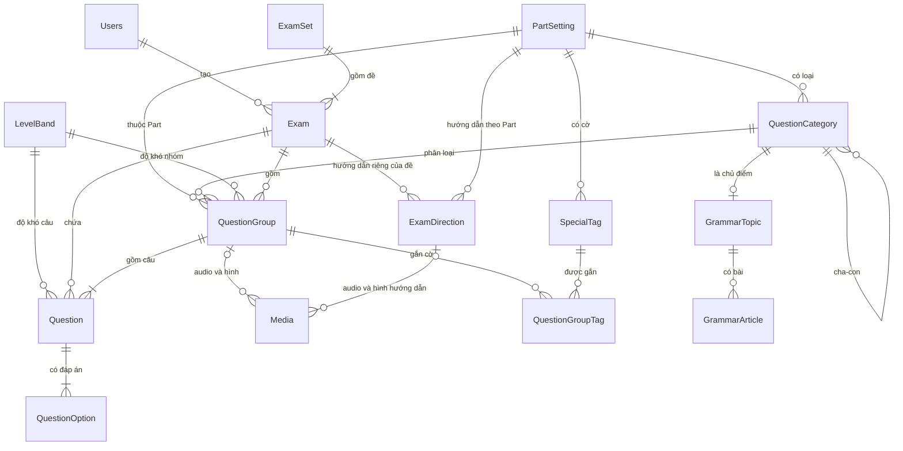
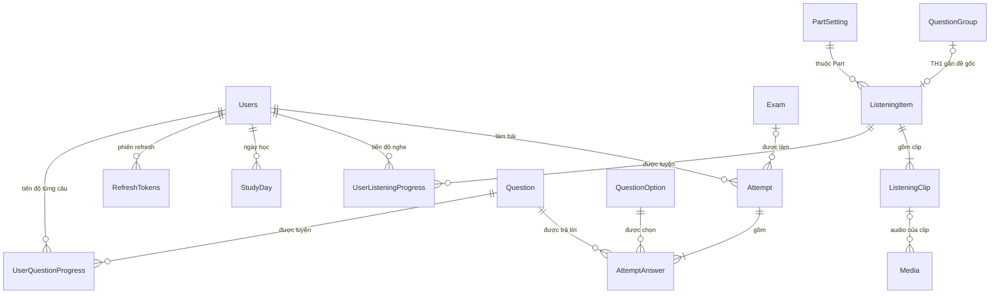
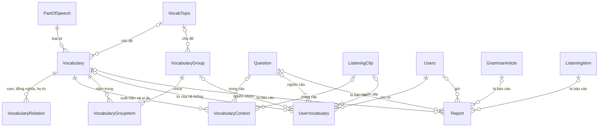

# THIẾT KẾ CƠ SỞ DỮ LIỆU v1.3 — HỆ THỐNG HỖ TRỢ HỌC VÀ LUYỆN THI TOEIC

| Mục | Nội dung |
|---|---|
| Phiên bản | **v1.3 — ĐÃ CHỐT** (thêm cấp bộ đề `ExamSet`; bổ sung hạ tầng auth theo triển khai 27/10/2026; thay thế v1.2). ASM-DB-01, 02, 03 đã chốt |
| Ngày | 29/10/2026 |
| Phase | 8 — Xác định dữ liệu |
| Đầu vào | v1.0; file đề mẫu `Test_1_split.xlsx` (đề 200 câu đầy đủ); các quyết định chốt trong trao đổi ngày 29/10/2026 |
| Hệ quản trị giả định | **SQL Server** |
| Quy mô | **32 bảng nghiệp vụ**, 8 nhóm; cộng 2 bảng hạ tầng auth (`RefreshTokens`, `PasswordResetOtps`, mục 6.9) |
| Script SQL Server | Sẽ viết lại thành bộ v1.2 (xem mục 17) |
| Nguyên tắc chủ đạo | Một mục đích một nơi; toàn vẹn ở tầng database; **chỉ xóa mềm** nội dung; dữ liệu dùng chung (từ vựng) không nhân bản theo đề |

---

## 1. TÓM TẮT THAY ĐỔI

### 1.0. So với v1.1

| # | Thay đổi | Lý do |
|---|---|---|
| 1 | Thêm bảng `ExamSet` (bộ đề): một bộ có nhiều đề; mỗi đề thuộc đúng một bộ (`Exam.ExamSetId` NN) | Người dùng yêu cầu: bộ "ETS 2024" gồm Đề 1, 2, 3; bộ "Đề tự soạn" gồm các đề nhập từ Excel (DB-DEC-24) |
| 2 | `Exam.ExamCode` và `Exam.Title` duy nhất **trong bộ**, không toàn cục | Hai bộ khác nhau có thể cùng có mã "ETSTest1" (DB-DEC-24) |
| 3 | Xóa mềm bộ đề chỉ khi không còn đề chưa xóa; bộ chỉ hiển thị cho người học khi có ít nhất một đề đã xuất bản | Tránh bộ "mồ côi" và bộ rỗng trên giao diện (DB-DEC-25) |
| 4 | Số bảng 31 → 32 | |

### 1.1. So với v1.0

| # | Thay đổi | Lý do |
|---|---|---|
| 1 | `Exam` thêm `ExamCode` (mã đề, ví dụ `ETSTest1`), duy nhất; mã này là tiền tố của mã nhóm trong Excel | Excel dùng mã nhóm có cấu trúc `{Mã đề}_Part {n}_{phạm vi câu}` |
| 2 | `QuestionGroup` **không lưu** mã nhóm Excel; `GroupOrder` suy ra từ câu nhỏ nhất của nhóm khi import | Mã nhóm chỉ là khóa nhập liệu, không cần trong database (DB-DEC-18) |
| 3 | `Question.LevelNo` nhận từ cột `level` (đã bỏ tên `difficulty`) | Thống nhất tên cột với thiết kế |
| 4 | Giải thích đáp án: **một cột** `Question.OptionExplanations` (NVARCHAR(MAX)), giữ nguyên nội dung ô Excel; hiển thị nguyên khối trên UI. **Bỏ** `QuestionOption.OptionNoteVi` | Chốt của người dùng: không tách theo đáp án trong database (DB-DEC-19) |
| 5 | Bỏ `Question.QuestionTextVi`. Bản dịch của mọi nhóm (kể cả Part 5, mỗi nhóm một câu) lưu ở `QuestionGroup.TranslationVi` | Một quy tắc cho mọi Part (DB-DEC-20) |
| 6 | `QuestionGroup.TranscriptEn` mở rộng sang Part 1 và 2 (Part 1: 4 đáp án được đọc; Part 2: câu hỏi và 3 đáp án được đọc). `TranslationVi` áp dụng cho mọi Part | Part 1, 2 có audio đọc thật, cần transcript đúng (DB-DEC-20) |
| 7 | `VocabularyContext` thêm `ContextMeaningVi` (nghĩa theo ngữ cảnh) | Một từ có thể mang nghĩa khác nhau theo câu (DB-DEC-21) |
| 8 | `Vocabulary.MeaningVi` nhận từ cột `meaning_base`. Khi upload đề mới mà từ đã có: **giữ nghĩa cũ, không ghi đè** | Chốt của người dùng (DB-DEC-21) |
| 9 | `ListeningClip` bỏ `ExternalId` (UNIQUEIDENTIFIER) và các cột dư; `ClipId` tự sinh | Chốt: không dùng `clip_id` từ file; bỏ `speaker`, `start_sec`, `end_sec`, `duration_sec`, `text_source`, `source_audio` (DB-DEC-23) |
| 10 | Quy tắc khớp clip TH1 chuyển từ tên file sang `group_code` + `question_no` + `seq` | Tên file audio không chứa Part và số câu (UC-28, BR-22) |
| 11 | Sheet `Media` của file đề **không dùng**. Bỏ `MimeType`, `FileSizeBytes`, `DurationSeconds` khỏi `Media`: bài thi không cần kích thước hay định dạng file, và thời lượng audio không dùng để chấm hay tính giờ | Chốt của người dùng |
| 12 | Quy trình import Excel (mục 11) mô tả lại đầy đủ theo cột mới | Đồng bộ với bố cục file v1.1 |

### 1.2. So với v0.5 đến v1.0 (giữ nguyên, tóm tắt)

Các thay đổi đã chốt ở v1.0 (hướng dẫn `ExamDirection`, `UserQuestionProgress`, `Attempt.DirectionSeconds`, một đồng hồ Reading 75 phút, `PartSetting.AudioPlayLimit`, khóa ngoại ghép, xóa mềm) **không đổi** trong v1.1 và v1.2.

---

## 2. MÀN HÌNH MẪU → MÔ HÌNH DỮ LIỆU

Có **hai kiểu luyện** dùng chung `Attempt` và `AttemptAnswer`:

| Kiểu | Màn hình | `ExamId` | `Mode` | `Scope` |
|---|---|---|---|---|
| **Trong phạm vi một test** | Ảnh 1 (tab Luyện thi) | Có | `EXAM` | `FULL`, `LISTENING`, `READING` hoặc `PART` |
| | Ảnh 2 (tab Luyện tập) | Có | `PRACTICE` | `PART` (kể cả "Chọn tất cả 7 Part") |
| **Theo ngân hàng câu hỏi** (xuyên mọi test) | Ảnh 3 (học theo Level, chủ điểm) | NULL | `PRACTICE` | `BANK` |

| Chức năng trên màn hình | Cách database đáp ứng |
|---|---|
| Full Test 120 phút, 200 câu | `Scope = FULL`, `TimeLimitSeconds = 7200` |
| Thi Listening 45 phút, 100 câu | `Scope = LISTENING`, 2700 giây |
| Thi Reading 75 phút, 100 câu | `Scope = READING`, 4500 giây |
| Thi theo Part | `Scope = PART`; các câu của Part đã chọn thành dòng `AttemptAnswer`; thời gian đề xuất tính từ `PartSetting.DefaultSecondsPerQuestion`; "Tự đặt" ghi vào `TimeLimitSeconds` |
| Số câu mỗi Part | `COUNT` theo (`ExamId`, `PartNo`), view `vw_ExamPartSummary` |
| Luyện tập: xem đáp án và giải thích ngay | API lưu và chấm từng câu ngay khi trả lời (`AttemptAnswer.IsCorrect`); hiển thị `Question.Explanation` và `Question.OptionExplanations` nguyên khối |
| Học theo ngân hàng: thẻ Level 1 đến 4 | Lọc theo `Question.LevelNo` |
| "Luyện theo chủ điểm": 4 thẻ | 4 nhóm cha của Part 5 trong `QuestionCategory` (`vocabulary`, `part_of_speech`, `verb`, `other_grammar`) |
| "Chưa luyện tập · 724 câu" | Suy ra từ `AttemptAnswer` và `UserQuestionProgress` |
| Nhãn PRO | **Future**: cột phân quyền ở `LevelBand`, `QuestionCategory` |
| Biểu tượng "xóa" trên thẻ | Xóa các dòng `UserQuestionProgress` của người học trong phạm vi thẻ; lịch sử làm bài giữ nguyên |
| Biểu tượng "làm lại" | `Attempt` mới (`Scope = BANK`); ôn câu sai chọn các câu có `UserQuestionProgress.LastIsCorrect = 0` |
| Ảnh 4: màn hình "LISTENING TEST" | `ExamDirection` (`DirectionKind = SECTION`, `Skill = LISTENING`) |
| Ảnh 5: hướng dẫn Part 1 | `ExamDirection` (`DirectionKind = PART`, `PartNo = 1`); hình và audio ở `Media` (`DirectionId`) |

---

## 3. QUY ƯỚC THIẾT KẾ

| Hạng mục | Quy ước |
|---|---|
| Tên bảng | PascalCase, số ít (riêng `Users`) |
| Khóa chính | `<Tên bảng>Id`, `INT IDENTITY(1,1)`; `AttemptAnswer` dùng `BIGINT`; danh mục cố định dùng mã tự nhiên (`PartNo`, `LevelNo`, `PosCode`) |
| Chuỗi | `NVARCHAR` cho tiếng Việt; `VARCHAR` cho mã kỹ thuật |
| Thời gian | `DATETIME2`, giờ UTC, mặc định `SYSUTCDATETIME()` |
| Giá trị liệt kê | `VARCHAR` + `CHECK ... IN (...)`; danh mục có tên hiển thị dùng bảng riêng |
| Tệp media | `StorageKey` tương đối (ví dụ `audio/ETSTest1/p3-032-034.mp3`); địa chỉ gốc ở cấu hình |
| Xóa mềm | `IsDeleted BIT` + `DeletedAt DATETIME2 NULL` (mục 7.4) |
| Mã nhập liệu Excel | **Không** lưu vào database (trừ `Exam.ExamCode`); xem mục 10 |
| Ký hiệu Null | **NN** = NOT NULL, **N** = cho phép NULL |

---

## 4. QUYẾT ĐỊNH THIẾT KẾ (DB-DEC)

| ID | Quyết định | Trạng thái |
|---|---|---|
| DB-DEC-01 | `Exam` không có `ExamType`, `PartNo`. Mọi đề đủ cấu trúc; Part nằm ở `QuestionGroup.PartNo` | Chốt |
| DB-DEC-02 | Xóa mềm cho nội dung Admin quản lý; bảng liên kết thuần được gỡ thật; dữ liệu cá nhân xóa thật sau 30 ngày (V2) | Chốt |
| DB-DEC-03 | Nhóm từ vựng - từ là N-N; một từ chỉ có một dòng, dùng lại ở nhiều nhóm | Chốt |
| DB-DEC-04 | Khi bắt đầu bài, tạo sẵn dòng `AttemptAnswer` cho mọi câu; lưu từng đáp án ngay khi trả lời | Chốt |
| DB-DEC-05 | Đáp án ở `QuestionOption`; đáp án đúng là `IsCorrect`; Part 2 (3 đáp án) và Part khác (4) dùng chung | Chốt |
| DB-DEC-06 | JWT, không có bảng phiên đăng nhập; `RefreshTokens` chỉ lưu hash, hạn dùng và trạng thái thu hồi theo UC DEC-011 | Chốt; bổ sung ánh xạ auth ngày 27/10/2026 |
| DB-DEC-07 | `Users.Role` (cột có CHECK), không có bảng `Roles` | Chốt |
| DB-DEC-08 | Cây phân loại một bảng; ngữ pháp có bảng `GrammarTopic` riêng liên kết 1-1 | Chốt |
| DB-DEC-09 | Audio, hình, đoạn văn, transcript, bản dịch, phân loại ở **cấp nhóm** | Chốt |
| DB-DEC-10 | `ListeningItem`/`ListeningClip` dùng chung cho TH1 (có `GroupId`) và TH2 (`GroupId` NULL) | Chốt (V2) |
| DB-DEC-11 | Từ vựng duy nhất theo (Lemma, PosCode); nơi xuất hiện ghi ở `VocabularyContext`; liên kết với đề suy ra qua câu hỏi | Chốt |
| DB-DEC-12 | `Attempt`: hai kiểu luyện (trong một test, theo ngân hàng câu hỏi) | Chốt |
| DB-DEC-13 | Hai lớp kiểm tra: cấu trúc do database ép; đầy đủ nội dung khi xuất bản bằng `sp_PublishExam` | Chốt |
| DB-DEC-14 | Transcript lưu ở nhóm (đề) và ở clip (luyện nghe, V2); cảnh báo khi lệch | Chốt |
| DB-DEC-15 | Từ vựng dùng khóa tự sinh `VocabId` + `UNIQUE (Lemma, PosCode)` | Chốt |
| DB-DEC-16 | `UserQuestionProgress`: tiến độ hiện tại, đặt lại được; lịch sử ở `Attempt` và `AttemptAnswer` | Chốt |
| DB-DEC-17 | `ExamDirection`: hướng dẫn cho từng phần thi và từng Part; `ExamId` NULL là mặc định dùng chung | Chốt |
| **DB-DEC-18** | **Mã nhóm trong Excel** (`{ExamCode}_Part {n}_{phạm vi câu}`, điền ở mọi dòng) chỉ dùng để nhập liệu và kiểm tra. Database không lưu mã này; `QuestionGroup.GroupOrder` = số câu nhỏ nhất của nhóm | Chốt (29/10/2026) |
| **DB-DEC-19** | Giải thích đáp án là **một cột** `Question.OptionExplanations`, không tách theo đáp án trong database; UI hiển thị nguyên khối. Quy tắc tách dòng và đối chiếu nhãn Đúng/Sai chỉ dùng để **kiểm tra** khi import | Chốt (29/10/2026) |
| **DB-DEC-20** | Mọi nhóm (kể cả Part 5) có `TranslationVi`; bỏ `Question.QuestionTextVi`. `TranscriptEn` có ở Part 1 đến 4 (Part 1, 2 là transcript đọc thật, không phải đáp án lặp lại) | Chốt (29/10/2026) |
| **DB-DEC-21** | Từ vựng: `Vocabulary.MeaningVi` (nghĩa gốc) chỉ ghi lần đầu; khi đề mới có nghĩa khác, **giữ nghĩa cũ**. Nghĩa theo ngữ cảnh lưu ở `VocabularyContext.ContextMeaningVi` | Chốt (29/10/2026) |
| **DB-DEC-22** | `Exam.ExamCode` do Admin nhập hoặc hệ thống tự sinh khi bỏ trống; duy nhất trong bộ theo DB-DEC-24. Khi sửa bỏ trống giữ mã hiện hành. Import chuẩn kiểm tra tiền tố nhóm khớp mã đề đang chọn | Chốt 29/10; cập nhật theo người dùng 30/10/2026 |
| **DB-DEC-23** | Luyện nghe clip (V2): bỏ `ExternalId`, `speaker`, `start_sec`, `end_sec`, `duration_sec`, `text_source`, `source_audio`; `ClipId` tự sinh. Quy ước tên file clip chốt khi làm V2 | Chốt (29/10/2026) |
| **DB-DEC-24** | Cấp bộ đề: `ExamSet` gồm nhiều `Exam`; mỗi đề thuộc đúng một bộ (`ExamSetId` NN). `ExamCode` và `Title` duy nhất trong bộ, không toàn cục | Chốt (29/10/2026) |
| **DB-DEC-25** | Xóa mềm bộ đề chỉ khi không còn đề chưa xóa; bộ chỉ hiển thị cho người học khi có ít nhất một đề đã xuất bản. Không có trạng thái riêng cho bộ | Chốt (29/10/2026) |
| **DB-DEC-26** | Đăng nhập Google: `Users.GoogleId` (NVARCHAR(100), unique có điều kiện `WHERE GoogleId IS NOT NULL`); `Users.PasswordHash` NULL với tài khoản chỉ đăng nhập Google; đăng nhập bằng mật khẩu bị từ chối khi `PasswordHash` NULL | Chốt theo triển khai 27/10/2026; còn mở ISSUE-034 (liên kết khi trùng email) |
| **DB-DEC-27** | Quên mật khẩu: mã OTP lưu dạng HMAC-SHA-256 với khóa bí mật phía máy chủ, không dùng SHA-256 thuần vì OTP chỉ 6 chữ số dễ dò; giới hạn số lần nhập sai; mã hết hạn và chỉ dùng một lần | Đề xuất 30/10/2026; chờ ISSUE-033 |

### 4.1. Vì sao không dùng chính từ vựng làm khóa chính

Giữ nguyên lý do ở v1.0: cùng chữ khác loại từ (*address* n/v), khóa là chuỗi dài làm index chậm, và sửa chính tả chỉ phải cập nhật một chỗ. `UNIQUE (Lemma, PosCode)` không lọc xóa mềm: từ đã xóa thì **khôi phục**, không tạo lại.

---

## 5. SƠ ĐỒ QUAN HỆ (ERD)

Quan hệ giữa các bảng **không đổi** so với v1.0; chỉ thay đổi thuộc tính (xem mục 6). Ba sơ đồ dưới đây giữ nguyên để tiện đọc.

### 5.1. Đề thi, phân loại, ngữ pháp, media



### 5.2. Làm bài, luyện nghe clip, tiến độ



### 5.3. Từ vựng, báo cáo



`ScoreConversion` không có khóa ngoại (tra theo `Skill`, `CorrectCount`).

---

## 6. TỪ ĐIỂN DỮ LIỆU (32 BẢNG)

Các bảng không ghi chú thay đổi giữ nguyên định nghĩa v1.0. Bảng có thay đổi được ghi rõ.

### 6.1. Người dùng

#### `Users` (không đổi)

| Thuộc tính | Kiểu | Null | Khóa | Mô tả / Ràng buộc |
|---|---|---|---|---|
| UserId | INT IDENTITY | NN | PK | |
| UserName | NVARCHAR(100) | NN | | Tên hiển thị; property C# là `Username`, tương ứng thông tin họ tên của UC-01 |
| Email | NVARCHAR(255) | NN | UNIQUE | Duy nhất (BR-01) |
| PasswordHash | NVARCHAR(255) | N | | Băm (BR-02); NULL đối với tài khoản đăng ký Google chưa thiết lập mật khẩu |
| GoogleId | NVARCHAR(100) | N | UNIQUE có điều kiện `WHERE GoogleId IS NOT NULL` | Mã định danh Google (`sub`); bổ sung theo `002_auth_extensions.sql` |
| Role | VARCHAR(10) | NN | | `CHECK IN ('LEARNER','ADMIN')`; mặc định `LEARNER` |
| Status | VARCHAR(10) | NN | | `CHECK IN ('ACTIVE','LOCKED')` (BR-03) |
| CreatedAt, UpdatedAt | DATETIME2 | NN | | |

Đối chiếu triển khai 27/10/2026: schema thực tế `ToeicDb` dùng `UserName` thay tên `FullName` trong bản thiết kế ban đầu; API hiện có giữ trường `username`. Đây là tên hiển thị, không phải định danh đăng nhập riêng và không có ràng buộc duy nhất. Đăng nhập dùng email. EF ánh xạ `Role` enum thành chuỗi qua attribute kiểu cột; SQL lưu timestamp UTC và mapper gán UTC khi trả DTO. DbContext tối giản, các ánh xạ cần thiết đặt trên model; không đổi schema. Cấu hình auth ở [TOEIC_Auth_Implementation.md](TOEIC_Auth_Implementation.md), ADR-001.

Xác thực dùng JWT access token ngắn hạn kèm refresh token lưu trong `RefreshTokens` (mục 6.9). Khóa tài khoản có hiệu lực ngay: API kiểm tra `Status` ở mỗi yêu cầu được bảo vệ.

---

### 6.2. Danh mục và cấu hình (seed)

#### `PartSetting` (không đổi)

| Thuộc tính | Kiểu | Null | Khóa | Mô tả / Ràng buộc |
|---|---|---|---|---|
| PartNo | TINYINT | NN | PK | `CHECK` 1 đến 7 |
| PartName | NVARCHAR(100) | NN | | |
| Skill | VARCHAR(10) | NN | | `LISTENING` hoặc `READING` |
| StandardQuestionCount | SMALLINT | NN | | Số câu chuẩn (kiểm tra khi xuất bản) |
| OptionCount | TINYINT | NN | | Part 2 là 3, còn lại 4 |
| DefaultSecondsPerQuestion | SMALLINT | N | | 27 (Part 1 đến 4), 45 (Part 5 đến 7). Chỉ dùng đề xuất thời gian cho "Thi theo Part" |
| AudioPlayLimit | TINYINT | N | | 1 với Part 1 đến 4; NULL với Part 5 đến 7 |

| PartNo | PartName | Skill | StandardQuestionCount | OptionCount | DefaultSecondsPerQuestion |
|---:|---|---|---:|---:|---:|
| 1 | Photographs | LISTENING | 6 | 4 | 27 |
| 2 | Question-Response | LISTENING | 25 | 3 | 27 |
| 3 | Conversations | LISTENING | 39 | 4 | 27 |
| 4 | Talks | LISTENING | 30 | 4 | 27 |
| 5 | Incomplete Sentences | READING | 30 | 4 | 45 |
| 6 | Text Completion | READING | 16 | 4 | 45 |
| 7 | Reading Comprehension | READING | 54 | 4 | 45 |

#### `LevelBand` (không đổi)

| Thuộc tính | Kiểu | Null | Khóa | Mô tả / Ràng buộc |
|---|---|---|---|---|
| LevelNo | TINYINT | NN | PK | `CHECK` 1 đến 4 |
| NameVi | NVARCHAR(50) | NN | | "Level 1 – Dưới 200", "Level 2 – 200–300", "Level 3 – 300–400", "Level 4 – 400–495" |
| ShortLabel | NVARCHAR(20) | NN | | |

#### `QuestionCategory` (cây phân loại, không đổi)

| Thuộc tính | Kiểu | Null | Khóa | Mô tả / Ràng buộc |
|---|---|---|---|---|
| CategoryId | INT IDENTITY | NN | PK | |
| PartNo | TINYINT | NN | FK → PartSetting | |
| ParentCategoryId | INT | N | FK ghép (ParentCategoryId, PartNo) → (CategoryId, PartNo) | NULL nếu là nút gốc; cha và con cùng Part |
| Code | VARCHAR(50) | NN | | Ví dụ `wh_question`, `vocabulary_noun` |
| NameVi | NVARCHAR(100) | NN | | |
| NameEn | NVARCHAR(200) | N | | |
| SortOrder | SMALLINT | NN | | |
| IsActive | BIT | NN | | Mặc định 1 (thay cho xóa) |

`UNIQUE (PartNo, Code)`; `UNIQUE (CategoryId, PartNo)`. Nhóm câu hỏi chỉ gắn vào nút **lá** (kiểm tra khi xuất bản).

#### `SpecialTag` (không đổi)

| Thuộc tính | Kiểu | Null | Khóa | Mô tả / Ràng buộc |
|---|---|---|---|---|
| SpecialTagId | INT IDENTITY | NN | PK | |
| PartNo | TINYINT | NN | FK → PartSetting | Chỉ Part 3, 4 |
| Code | VARCHAR(50) | NN | | `chart_or_table`, `three_speakers`, `implied_question` |
| NameVi | NVARCHAR(100) | NN | | |

`UNIQUE (PartNo, Code)`; `UNIQUE (SpecialTagId, PartNo)`. Seed 5 dòng.

#### `PartOfSpeech` (không đổi)

| Thuộc tính | Kiểu | Null | Khóa | Mô tả / Ràng buộc |
|---|---|---|---|---|
| PosCode | VARCHAR(10) | NN | PK | `n`, `v`, `adj`, `adv`, `prep`, `phr`, `phr.v` (7 mã, khớp file đề) |
| NameVi | NVARCHAR(50) | NN | | |

#### `ScoreConversion` (không đổi)

| Thuộc tính | Kiểu | Null | Khóa | Mô tả / Ràng buộc |
|---|---|---|---|---|
| Skill | VARCHAR(10) | NN | PK (1/2) | |
| CorrectCount | SMALLINT | NN | PK (2/2) | `CHECK` 0 đến 100 |
| ScaledScore | SMALLINT | NN | | `CHECK` 5 đến 495 |

---

### 6.3. Đề thi và câu hỏi

#### `ExamSet` (**mới**: bộ đề)

| Thuộc tính | Kiểu | Null | Khóa | Mô tả / Ràng buộc |
|---|---|---|---|---|
| ExamSetId | INT IDENTITY | NN | PK | |
| Name | NVARCHAR(150) | NN | UNIQUE có điều kiện `WHERE IsDeleted = 0` | Tên bộ, ví dụ "ETS 2024", "Đề tự soạn" |
| Description | NVARCHAR(1000) | N | | |
| IsDeleted | BIT | NN | | Xóa mềm; chỉ khi không còn đề chưa xóa (BR-34) |
| DeletedAt | DATETIME2 | N | | |
| CreatedBy | INT | NN | FK → Users | |
| CreatedAt, UpdatedAt | DATETIME2 | NN | | |

Bộ không có trạng thái riêng. Bộ hiển thị cho người học khi có ít nhất một đề `PUBLISHED` (view `vw_ExamSetSummary`). Không seed sẵn; Admin tạo các bộ (ví dụ "Đề tự soạn").

#### `Exam` (**thêm `ExamCode`**)

| Thuộc tính | Kiểu | Null | Khóa | Mô tả / Ràng buộc |
|---|---|---|---|---|
| ExamId | INT IDENTITY | NN | PK | |
| ExamSetId | INT | NN | FK → ExamSet | **Mới.** Đề thuộc đúng một bộ (BR-33) |
| ExamCode | VARCHAR(30) | NN | UNIQUE `(ExamSetId, ExamCode)` có điều kiện `WHERE IsDeleted = 0` | Mã đề nhập hoặc server sinh khi bỏ trống (quyết định người dùng 30/10/2026); là tiền tố mã nhóm trong Excel chuẩn; duy nhất trong bộ |
| Title | NVARCHAR(200) | NN | | Tên hiển thị, ví dụ "ETS Test 1". Duy nhất trong bộ đề chưa xóa |
| Description | NVARCHAR(1000) | N | | |
| Status | VARCHAR(10) | NN | | `CHECK IN ('DRAFT','PUBLISHED')`; mặc định `DRAFT` |
| IsPublic | BIT | NN | | Mặc định 0; Khách làm được khi bật (V2) |
| IsDeleted | BIT | NN | | Xóa mềm |
| DeletedAt | DATETIME2 | N | | |
| CreatedBy | INT | NN | FK → Users | |
| CreatedAt, UpdatedAt | DATETIME2 | NN | | |

Đề luôn đủ cấu trúc 7 Part (200 câu); kiểm tra khi xuất bản.

#### `QuestionGroup` (**đổi**: bỏ mã nhóm Excel, mở rộng transcript và bản dịch)

Part của mọi câu hỏi lấy từ `PartNo` của nhóm. Audio, hình, đoạn văn, transcript, bản dịch, phân loại, độ khó nhóm lưu **một lần** ở đây.

| Thuộc tính | Kiểu | Null | Khóa | Mô tả / Ràng buộc |
|---|---|---|---|---|
| GroupId | INT IDENTITY | NN | PK | |
| ExamId | INT | NN | FK → Exam | |
| PartNo | TINYINT | NN | FK → PartSetting | Nguồn duy nhất cho Part của câu hỏi |
| GroupOrder | SMALLINT | NN | | **Suy ra khi import** = số câu nhỏ nhất của nhóm. `UNIQUE (ExamId, GroupOrder)` |
| CategoryId | INT | NN | FK ghép (CategoryId, PartNo) → QuestionCategory | Phân loại đúng Part (lá) |
| GroupLevelNo | TINYINT | N | FK → LevelBand | `CHECK`: chỉ Part 3, 4, 6, 7 |
| PassageHtml | NVARCHAR(MAX) | N | | `CHECK`: chỉ Part 6, 7; nhiều đoạn tách bằng `<hr>` (5 nhóm Part 7 đã kiểm tra) |
| TranscriptEn | NVARCHAR(MAX) | N | | **Đổi:** `CHECK`: chỉ Part 1 đến 4. Part 1: 4 đáp án được đọc; Part 2: câu hỏi và 3 đáp án được đọc; Part 3, 4: đoạn hội thoại/bài nói có tiền tố người nói (`W:`, `M:`) |
| TranslationVi | NVARCHAR(MAX) | N | | **Đổi:** áp dụng mọi Part. Bản dịch của transcript (Part 1 đến 4), passage (Part 6, 7) hoặc câu hỏi (Part 5, vì mỗi nhóm một câu) |
| IsDeleted | BIT | NN | | |
| DeletedAt | DATETIME2 | N | | |
| CreatedAt, UpdatedAt | DATETIME2 | NN | | |

Đích khóa ngoại ghép: `UNIQUE (GroupId, PartNo)`, `UNIQUE (GroupId, ExamId)`.

#### `QuestionGroupTag` (liên kết thuần; được gỡ thật, không đổi)

| Thuộc tính | Kiểu | Null | Khóa | Mô tả / Ràng buộc |
|---|---|---|---|---|
| GroupId | INT | NN | PK (1/2), FK ghép (GroupId, PartNo) → QuestionGroup | |
| SpecialTagId | INT | NN | PK (2/2), FK ghép (SpecialTagId, PartNo) → SpecialTag | |
| PartNo | TINYINT | NN | | Cột "bắt cầu" |

#### `Media` (file dùng chung cho nhóm, clip và hướng dẫn; không đổi cấu trúc)

| Thuộc tính | Kiểu | Null | Khóa | Mô tả / Ràng buộc |
|---|---|---|---|---|
| MediaId | INT IDENTITY | NN | PK | |
| GroupId | INT | N | FK ghép (GroupId, PartNo) → QuestionGroup | File của nhóm câu hỏi |
| PartNo | TINYINT | N | | Cột "bắt cầu", chỉ có khi `GroupId` có giá trị |
| ClipId | INT | N | FK → ListeningClip | File audio của clip (V2) |
| DirectionId | INT | N | FK → ExamDirection | File audio hoặc hình của hướng dẫn |
| MediaType | VARCHAR(10) | NN | | `CHECK IN ('AUDIO','IMAGE')` |
| StorageKey | NVARCHAR(500) | NN | UNIQUE | Khóa lưu trữ tương đối, lấy từ đường dẫn file khi upload |
| AltText | NVARCHAR(300) | N | | Mô tả hình (truy cập) |
| SortOrder | TINYINT | NN | | Mặc định 1 |
| IsDeleted | BIT | NN | | |
| DeletedAt | DATETIME2 | N | | |
| CreatedAt | DATETIME2 | NN | | |

Ràng buộc CHECK:
- Đúng **một** trong `GroupId`, `ClipId`, `DirectionId` có giá trị.
- `ClipId IS NULL OR MediaType = 'AUDIO'`.
- `GroupId IS NULL OR MediaType = 'IMAGE' OR PartNo BETWEEN 1 AND 4`: audio của nhóm chỉ ở Listening.
- Unique có điều kiện `(GroupId) WHERE MediaType = 'AUDIO' AND IsDeleted = 0` và `(ClipId) WHERE IsDeleted = 0`.
- Unique có điều kiện `(DirectionId, MediaType) WHERE IsDeleted = 0`.

#### `Question` (**đổi**: thêm `OptionExplanations`, bỏ `QuestionTextVi`)

| Thuộc tính | Kiểu | Null | Khóa | Mô tả / Ràng buộc |
|---|---|---|---|---|
| QuestionId | INT IDENTITY | NN | PK | |
| GroupId | INT | NN | FK ghép (GroupId, ExamId) → QuestionGroup | Câu luôn cùng đề với nhóm |
| ExamId | INT | NN | | Cột "bắt cầu" |
| QuestionNo | SMALLINT | NN | | Duy nhất `(ExamId, QuestionNo) WHERE IsDeleted = 0`; số câu 1 đến 200 |
| LevelNo | TINYINT | N | FK → LevelBand | **Nhận từ cột `level`**; bắt buộc khi xuất bản |
| QuestionText | NVARCHAR(MAX) | N | | Đề bài. Trống ở Part 1 và Part 6 (vị trí trống nằm trong passage). Part 2 là câu hỏi được đọc |
| Explanation | NVARCHAR(MAX) | N | | Lập luận từng bước và kiến thức liên quan; bắt buộc khi xuất bản (BR-08) |
| OptionExplanations | NVARCHAR(MAX) | N | | **Mới.** Giải thích từng phương án gom trong **một ô**, mỗi phương án một dòng `X: ... - Đúng/Sai, ...`. Hiển thị nguyên khối; bắt buộc khi xuất bản (BR-08). Chi tiết ở mục 10.3 |
| IsDeleted | BIT | NN | | |
| DeletedAt | DATETIME2 | N | | |
| CreatedAt, UpdatedAt | DATETIME2 | NN | | |

#### `QuestionOption` (**đổi**: bỏ `OptionNoteVi`)

| Thuộc tính | Kiểu | Null | Khóa | Mô tả / Ràng buộc |
|---|---|---|---|---|
| OptionId | INT IDENTITY | NN | PK | |
| QuestionId | INT | NN | FK → Question | |
| OptionLabel | CHAR(1) | NN | | `A` đến `D`; `UNIQUE (QuestionId, OptionLabel)` |
| OptionText | NVARCHAR(1000) | NN | | Nội dung đáp án |
| IsCorrect | BIT | NN | | Unique có điều kiện `(QuestionId) WHERE IsCorrect = 1`; đúng một đáp án đúng khi xuất bản |

`UNIQUE (OptionId, QuestionId)` làm đích cho khóa ngoại ghép của `AttemptAnswer`. Không xóa riêng lẻ; chỉ sửa tại chỗ.

#### `ExamDirection` (không đổi)

| Thuộc tính | Kiểu | Null | Khóa | Mô tả / Ràng buộc |
|---|---|---|---|---|
| DirectionId | INT IDENTITY | NN | PK | |
| ExamId | INT | N | FK → Exam | NULL = bản mặc định dùng chung |
| DirectionKind | VARCHAR(10) | NN | | `SECTION` hoặc `PART` |
| Skill | VARCHAR(10) | N | | `LISTENING` hoặc `READING`; chỉ khi `SECTION` |
| PartNo | TINYINT | N | FK → PartSetting | Chỉ khi `PART` |
| DirectionsEn | NVARCHAR(MAX) | NN | | Văn bản thuần |
| DirectionsVi | NVARCHAR(MAX) | N | | Bản dịch |
| ExampleEn | NVARCHAR(MAX) | N | | Giải thích câu ví dụ (chỉ Part 1 có trong file mẫu) |
| ExampleVi | NVARCHAR(MAX) | N | | |
| IsDeleted | BIT | NN | | |
| DeletedAt | DATETIME2 | N | | |
| CreatedAt, UpdatedAt | DATETIME2 | NN | | |

CHECK: `(DirectionKind = 'SECTION' AND Skill IS NOT NULL AND PartNo IS NULL) OR (DirectionKind = 'PART' AND PartNo IS NOT NULL AND Skill IS NULL)`. Unique có điều kiện `(ExamId, DirectionKind, Skill, PartNo) WHERE IsDeleted = 0`. Bộ mặc định gồm 9 dòng. Tiêu đề và thứ tự hiển thị suy ra từ `Skill` hoặc `PartNo`.

---

### 6.4. Ngữ pháp (không đổi)

#### `GrammarTopic` (15 chủ điểm)

| Thuộc tính | Kiểu | Null | Khóa | Mô tả / Ràng buộc |
|---|---|---|---|---|
| GrammarTopicId | INT IDENTITY | NN | PK | |
| CategoryId | INT | NN | UNIQUE, FK ghép (CategoryId, PartNo) → QuestionCategory | 1-1 với một lá của cây phân loại |
| PartNo | TINYINT | NN | | `CHECK (PartNo = 5)`, mặc định 5 |
| SortOrder | TINYINT | NN | | |
| Summary | NVARCHAR(500) | N | | |

Seed 15: `noun`, `adjective`, `adverb`, `tense`, `subject_verb_agreement`, `active_passive_voice`, `gerund`, `imperative`, `verb_form`, `pronoun`, `comparison`, `conjunction_preposition`, `relative_clause`, `conditional_sentence`, `adverbial_clause`.

#### `GrammarArticle` (không đổi)

| Thuộc tính | Kiểu | Null | Khóa | Mô tả / Ràng buộc |
|---|---|---|---|---|
| ArticleId | INT IDENTITY | NN | PK | |
| GrammarTopicId | INT | NN | FK → GrammarTopic | |
| Title | NVARCHAR(200) | NN | | |
| Content | NVARCHAR(MAX) | NN | | Gồm ví dụ minh họa |
| SortOrder | SMALLINT | NN | | |
| IsDeleted | BIT | NN | | |
| DeletedAt | DATETIME2 | N | | |
| CreatedAt, UpdatedAt | DATETIME2 | NN | | |

---

### 6.5. Luyện nghe clip (V2)

#### `ListeningItem` (không đổi)

| Thuộc tính | Kiểu | Null | Khóa | Mô tả / Ràng buộc |
|---|---|---|---|---|
| ItemId | INT IDENTITY | NN | PK | |
| PartNo | TINYINT | NN | FK → PartSetting | `CHECK` 1 đến 4 |
| GroupId | INT | N | FK ghép (GroupId, PartNo) → QuestionGroup | TH1: trỏ tới nhóm đề gốc; TH2: NULL. Unique có điều kiện `(GroupId) WHERE GroupId IS NOT NULL AND IsDeleted = 0` |
| CategoryId | INT | N | FK ghép (CategoryId, PartNo) → QuestionCategory | Chỉ TH2 |
| LevelNo | TINYINT | N | FK → LevelBand | Chỉ TH2 |
| SourceNote | NVARCHAR(200) | N | | Ghi chú nguồn (TH2) |
| IsPublished | BIT | NN | | Mặc định 0 |
| IsDeleted | BIT | NN | | |
| DeletedAt | DATETIME2 | N | | |
| CreatedAt, UpdatedAt | DATETIME2 | NN | | |

`CHECK (GroupId IS NULL OR (CategoryId IS NULL AND LevelNo IS NULL))`. TH2 phải có `CategoryId`, `LevelNo` trước khi xuất bản. `ExternalKey` đã bỏ ở v1.1 (không còn nguồn file cần giữ).

#### `ListeningClip` (**đổi**: bỏ `ExternalId`)

| Thuộc tính | Kiểu | Null | Khóa | Mô tả / Ràng buộc |
|---|---|---|---|---|
| ClipId | INT IDENTITY | NN | PK | **Tự sinh**, không lấy từ file |
| ItemId | INT | NN | FK ghép (ItemId, PartNo) → ListeningItem | |
| PartNo | TINYINT | NN | | Cột "bắt cầu" |
| SeqNo | SMALLINT | NN | | `UNIQUE (ItemId, SeqNo)` (lọc `IsDeleted = 0`) |
| ClipRole | VARCHAR(10) | NN | | `SENTENCE`, `QUESTION`, `OPTION_A` đến `OPTION_D` |
| TranscriptEn | NVARCHAR(1000) | NN | | |
| TranslationVi | NVARCHAR(1000) | N | | |
| IsDeleted | BIT | NN | | |
| DeletedAt | DATETIME2 | N | | |
| CreatedAt | DATETIME2 | NN | | |

Đã bỏ: `ExternalId`, `Speaker`, `StartSec`, `EndSec` (DB-DEC-23). File audio nằm ở `Media` (`ClipId`). `CHECK` vai trò theo Part: Part 1 chỉ `OPTION_A..D`; Part 2 chỉ `QUESTION`, `OPTION_A..C`; Part 3, 4 chỉ `SENTENCE`.

#### `UserListeningProgress` (không đổi)

| Thuộc tính | Kiểu | Null | Khóa | Mô tả / Ràng buộc |
|---|---|---|---|---|
| UserId | INT | NN | PK (1/2), FK → Users | |
| ItemId | INT | NN | PK (2/2), FK → ListeningItem | |
| PracticeCount | INT | NN | | |
| FirstPracticedAt, LastPracticedAt | DATETIME2 | NN | | |
| LastMode | VARCHAR(20) | N | | Chế độ luyện gần nhất |
| LastAccuracy, BestAccuracy | DECIMAL(5,2) | N | | 0 đến 100 |

---

### 6.6. Làm bài và kết quả (không đổi)

#### `Attempt`

| Thuộc tính | Kiểu | Null | Khóa | Mô tả / Ràng buộc |
|---|---|---|---|---|
| AttemptId | INT IDENTITY | NN | PK | |
| UserId | INT | NN | FK → Users | `ON DELETE CASCADE` (V2) |
| ExamId | INT | N | FK → Exam | NULL khi `Scope = BANK` |
| Mode | VARCHAR(10) | NN | | `EXAM` hoặc `PRACTICE` |
| Scope | VARCHAR(10) | NN | | `FULL`, `LISTENING`, `READING`, `PART`, `BANK` |
| Status | VARCHAR(12) | NN | | `IN_PROGRESS`, `SUBMITTED`, `ABANDONED`, `ERROR` |
| TimeLimitSeconds | INT | N | | `EXAM`: bắt buộc; `PRACTICE`: NULL |
| StartedAt | DATETIME2 | NN | | |
| SubmittedAt | DATETIME2 | N | | |
| IsAutoSubmitted | BIT | NN | | |
| DirectionSeconds | INT | NN | | Thời gian xem hướng dẫn, không tính đồng hồ; mặc định 0 |
| DurationSeconds | INT | N | | `(SubmittedAt − StartedAt) − DirectionSeconds` |
| TotalQuestions | SMALLINT | NN | | |
| CorrectCount | SMALLINT | N | | |
| ListeningScaled, ReadingScaled, TotalScaled | SMALLINT | N | | NULL nếu không đủ điều kiện (BR-07) |
| IsDeleted | BIT | NN | | Người học ẩn lịch sử bằng xóa mềm |
| DeletedAt | DATETIME2 | N | | |

CHECK:
- `(Scope = 'BANK' AND ExamId IS NULL) OR (Scope <> 'BANK' AND ExamId IS NOT NULL)`.
- `Scope <> 'BANK' OR Mode = 'PRACTICE'`.
- `Mode <> 'EXAM' OR TimeLimitSeconds IS NOT NULL`.
- `Status <> 'SUBMITTED' OR SubmittedAt IS NOT NULL`.
- Điểm quy đổi chỉ khác NULL khi `Status = 'SUBMITTED'`.

Các Part của một lần làm bài không lưu riêng: suy ra từ `AttemptAnswer` (view `vw_AttemptSummary`).

#### `AttemptAnswer`

| Thuộc tính | Kiểu | Null | Khóa | Mô tả / Ràng buộc |
|---|---|---|---|---|
| AttemptAnswerId | BIGINT IDENTITY | NN | PK | |
| AttemptId | INT | NN | FK → Attempt | `ON DELETE CASCADE` |
| QuestionId | INT | NN | FK → Question | `UNIQUE (AttemptId, QuestionId)` |
| SelectedOptionId | INT | N | FK ghép (QuestionId, SelectedOptionId) → QuestionOption (QuestionId, OptionId) | NULL = chưa trả lời |
| IsCorrect | BIT | N | | `PRACTICE`: có ngay khi trả lời; `EXAM`: chốt khi nộp |
| DisplayedAt | DATETIME2 | N | | Thời điểm câu hiển thị |
| AnsweredAt | DATETIME2 | N | | |

Tạo sẵn dòng cho mọi câu khi bắt đầu bài (DB-DEC-04). Với `BANK`, các dòng này là danh sách câu của lần luyện.

#### `UserQuestionProgress` (không đổi)

| Thuộc tính | Kiểu | Null | Khóa | Mô tả / Ràng buộc |
|---|---|---|---|---|
| UserId | INT | NN | PK (1/2), FK → Users | `ON DELETE CASCADE` |
| QuestionId | INT | NN | PK (2/2), FK → Question | |
| LastIsCorrect | BIT | NN | | Kết quả lần trả lời gần nhất; câu sai là `LastIsCorrect = 0` |
| LastAnsweredAt | DATETIME2 | NN | | |

Chỉ ghi khi luyện ở chế độ Luyện tập và học theo ngân hàng (BR-26). Chưa có dòng nghĩa là "chưa luyện".

---

### 6.7. Từ vựng

#### `VocabTopic` (không đổi)

| Thuộc tính | Kiểu | Null | Khóa | Mô tả / Ràng buộc |
|---|---|---|---|---|
| VocabTopicId | INT IDENTITY | NN | PK | |
| Name | NVARCHAR(100) | NN | UNIQUE | Seed và Admin thêm (ISSUE-014) |
| Description | NVARCHAR(300) | N | | |

#### `Vocabulary` (**đổi**: nguồn dữ liệu và quy tắc upsert)

Mỗi từ (từ gốc + loại từ) **chỉ có một dòng**, dùng chung cho mọi đề.

| Thuộc tính | Kiểu | Null | Khóa | Mô tả / Ràng buộc |
|---|---|---|---|---|
| VocabId | INT IDENTITY | NN | PK | |
| Lemma | NVARCHAR(100) | NN | UNIQUE (Lemma, PosCode) | Từ gốc (cột `base`) |
| PosCode | VARCHAR(10) | NN | FK → PartOfSpeech | Cột `pos` |
| IpaUs | NVARCHAR(100) | N | | Cột `ipa` |
| IpaUk | NVARCHAR(100) | N | | Chưa có trong file đề; NULL đến khi có nguồn |
| CefrLevel | CHAR(2) | NN | | Cột `cefr`; `CHECK IN ('A1','A2','B1','B2','C1','C2')` |
| MeaningVi | NVARCHAR(500) | NN | | **Nghĩa gốc**, nhận từ cột `meaning_base`. Chỉ ghi lần đầu; khi đề sau có nghĩa khác, giữ nghĩa cũ (DB-DEC-21) |
| DefinitionEn | NVARCHAR(1000) | N | | Tùy chọn (file đề hiện trống) |
| VocabTopicId | INT | N | FK → VocabTopic | NULL đến khi gán chủ đề |
| IsDeleted | BIT | NN | | |
| DeletedAt | DATETIME2 | N | | |
| CreatedAt, UpdatedAt | DATETIME2 | NN | | |

`UNIQUE (Lemma, PosCode)` **không lọc xóa mềm**: từ đã xóa thì khôi phục, không tạo lại.

#### `VocabularyRelation` (không đổi)

| Thuộc tính | Kiểu | Null | Khóa | Mô tả / Ràng buộc |
|---|---|---|---|---|
| RelationId | INT IDENTITY | NN | PK | |
| VocabId | INT | NN | FK → Vocabulary | |
| RelationType | VARCHAR(12) | NN | | `COLLOCATION`, `SYNONYM`, `ANTONYM`, `WORD_FAMILY` |
| RelatedText | NVARCHAR(200) | NN | | |
| RelatedMeaningVi | NVARCHAR(300) | N | | |
| SortOrder | TINYINT | NN | | |
| IsDeleted | BIT | NN | | |
| DeletedAt | DATETIME2 | N | | |

`UNIQUE (VocabId, RelationType, RelatedText) WHERE IsDeleted = 0`.

#### `VocabularyContext` (**đổi**: thêm `ContextMeaningVi`)

Nơi duy nhất lưu ví dụ và nghĩa theo ngữ cảnh. Liên kết từ với đề: từ → câu hỏi → đề (hoặc từ → clip → nhóm → đề).

| Thuộc tính | Kiểu | Null | Khóa | Mô tả / Ràng buộc |
|---|---|---|---|---|
| ContextId | INT IDENTITY | NN | PK | |
| VocabId | INT | NN | FK → Vocabulary | |
| QuestionId | INT | N | FK → Question | Từ nằm trong câu hỏi (đề) |
| ClipId | INT | N | FK → ListeningClip | Từ nằm trong clip (V2) |
| SurfaceForm | NVARCHAR(100) | N | | Cột `term`: dạng xuất hiện trong bài (ví dụ `holding` của từ gốc `hold`) |
| ContextMeaningVi | NVARCHAR(500) | N | | **Mới.** Cột `term_meaning_vi`: nghĩa của dạng xuất hiện trong câu này |
| ExampleEn | NVARCHAR(1000) | N | | Cột `example_en` |
| ExampleVi | NVARCHAR(1000) | N | | Cột `example_vi` |
| IsDeleted | BIT | NN | | |
| DeletedAt | DATETIME2 | N | | |

CHECK: có **tối đa một** trong `QuestionId`, `ClipId` (cả hai trống = mục do Admin nhập tay). Unique có điều kiện `(QuestionId, VocabId, SurfaceForm) WHERE IsDeleted = 0` và `(ClipId, VocabId, SurfaceForm) WHERE IsDeleted = 0`.

#### `VocabularyGroup` (không đổi)

| Thuộc tính | Kiểu | Null | Khóa | Mô tả / Ràng buộc |
|---|---|---|---|---|
| VocabGroupId | INT IDENTITY | NN | PK | |
| Name | NVARCHAR(150) | NN | | Duy nhất trong nhóm chưa xóa |
| VocabTopicId | INT | N | FK → VocabTopic | |
| Description | NVARCHAR(500) | N | | |
| IsPublished | BIT | NN | | |
| IsDeleted | BIT | NN | | |
| DeletedAt | DATETIME2 | N | | |
| CreatedAt, UpdatedAt | DATETIME2 | NN | | |

#### `VocabularyGroupItem` (liên kết thuần; được gỡ thật, không đổi)

| Thuộc tính | Kiểu | Null | Khóa | Mô tả / Ràng buộc |
|---|---|---|---|---|
| VocabGroupId | INT | NN | PK (1/2), FK → VocabularyGroup | |
| VocabId | INT | NN | PK (2/2), FK → Vocabulary | |
| SortOrder | SMALLINT | NN | | |

#### `UserVocabulary` (không đổi)

Từ của hệ thống chỉ tham chiếu (`VocabId`), không sao chép. Từ tự thêm có chữ riêng.

| Thuộc tính | Kiểu | Null | Khóa | Mô tả / Ràng buộc |
|---|---|---|---|---|
| UserVocabId | INT IDENTITY | NN | PK | |
| UserId | INT | NN | FK → Users | `ON DELETE CASCADE` |
| VocabId | INT | N | FK → Vocabulary | |
| CustomWord | NVARCHAR(100) | N | | |
| CustomMeaning | NVARCHAR(500) | N | | |
| CustomExample | NVARCHAR(1000) | N | | |
| SourceQuestionId | INT | N | FK → Question | |
| SourceClipId | INT | N | FK → ListeningClip | |
| SourceVocabGroupId | INT | N | FK → VocabularyGroup | |
| CreatedAt | DATETIME2 | NN | | |

CHECK: đúng một trong hai cách (có `VocabId`, hoặc có cả `CustomWord` và `CustomMeaning`); tối đa một cột nguồn. Unique có điều kiện `(UserId, VocabId) WHERE VocabId IS NOT NULL` và `(UserId, CustomWord) WHERE CustomWord IS NOT NULL` (BR-14).

---

### 6.8. Báo cáo và tiến độ (không đổi)

#### `Report`

| Thuộc tính | Kiểu | Null | Khóa | Mô tả / Ràng buộc |
|---|---|---|---|---|
| ReportId | INT IDENTITY | NN | PK | |
| ReporterId | INT | N | FK → Users | `ON DELETE SET NULL` |
| TargetType | VARCHAR(20) | NN | | `QUESTION`, `VOCABULARY`, `GRAMMAR_ARTICLE`, `LISTENING_ITEM` |
| QuestionId, VocabId, ArticleId, ListeningItemId | INT | N | FK | Đúng một cột có giá trị, khớp `TargetType` |
| ErrorType | VARCHAR(20) | NN | | `WRONG_ANSWER`, `WRONG_EXPLANATION`, `MEDIA_ERROR`, `TYPO`, `OTHER` |
| Description | NVARCHAR(1000) | N | | Bắt buộc khi `OTHER` |
| Status | VARCHAR(12) | NN | | `NEW`, `IN_PROGRESS`, `RESOLVED`, `REJECTED` |
| AdminNote | NVARCHAR(1000) | N | | |
| HandledBy | INT | N | FK → Users | |
| CreatedAt, HandledAt | DATETIME2 | NN / N | | |

Unique có điều kiện chống trùng báo cáo chưa xử lý của cùng người cho cùng đối tượng.

#### `StudyDay` (không đổi)

| Thuộc tính | Kiểu | Null | Khóa | Mô tả / Ràng buộc |
|---|---|---|---|---|
| UserId | INT | NN | PK (1/2), FK → Users | `ON DELETE CASCADE` |
| StudyDate | DATE | NN | PK (2/2) | Theo múi giờ người học |
| AttemptCount | SMALLINT | NN | | |
| ClipPracticeCount | SMALLINT | NN | | |

---

#### `RefreshTokens` — hạ tầng auth theo UC DEC-011

| Thuộc tính | Kiểu | Null | Khóa | Mô tả / Ràng buộc |
|---|---|---|---|---|
| RefreshTokenId | BIGINT IDENTITY | NN | PK | |
| UserId | INT | NN | FK → Users | ON DELETE CASCADE |
| TokenHash | CHAR(64) | NN | UNIQUE | SHA-256 hex; không lưu token gốc |
| CreatedAt | DATETIME2 | NN | | Mặc định SYSUTCDATETIME() |
| ExpiresAt | DATETIME2 | NN | | CHECK ExpiresAt > CreatedAt |
| RevokedAt | DATETIME2 | N | | NULL khi chưa thu hồi |

Token gốc chỉ trả client. Xoay vòng là một transaction thu hồi token cũ có điều kiện và thêm token mới; nếu insert lỗi phải rollback. Index `UserId` hỗ trợ thu hồi theo người dùng. Schema auth hiện được hợp nhất trong nguồn chuẩn `../DATABASE/01_schema.sql`; không duy trì baseline auth riêng trong backend.

#### `PasswordResetOtps` — hạ tầng quên mật khẩu (chờ ISSUE-033)

| Thuộc tính | Kiểu | Null | Khóa | Mô tả / Ràng buộc |
|---|---|---|---|---|
| OtpId | BIGINT IDENTITY | NN | PK | |
| Email | NVARCHAR(255) | NN | | Không FK tới Users: yêu cầu có thể gửi cho email chưa có tài khoản |
| OtpHash | CHAR(64) | NN | | HMAC-SHA-256 của mã OTP với khóa bí mật phía máy chủ (DB-DEC-27) |
| ExpiresAt | DATETIME2 | NN | | |
| AttemptsCount | INT | NN | | Mặc định 0; vượt ngưỡng thì vô hiệu mã |
| IsUsed | BIT | NN | | Mặc định 0; mã chỉ dùng một lần |
| CreatedAt | DATETIME2 | NN | | |

Index `(Email, ExpiresAt, IsUsed)`. Đề xuất có job dọn bản ghi hết hạn quá 24 giờ.

---

## 7. CƠ CHẾ BẢO ĐẢM TOÀN VẸN

### 7.1. Khóa ngoại ghép

| FK ghép | Bảo đảm |
|---|---|
| `Question (GroupId, ExamId)` → `QuestionGroup` | Câu hỏi cùng đề với nhóm |
| `QuestionGroup (CategoryId, PartNo)` → `QuestionCategory` | Phân loại đúng Part |
| `QuestionCategory (ParentCategoryId, PartNo)` → chính nó | Cha và con cùng Part |
| `GrammarTopic (CategoryId, PartNo=5)` → `QuestionCategory` | Chủ điểm ngữ pháp là loại của Part 5 |
| `QuestionGroupTag` (2 FK ghép) | Cờ và nhóm cùng Part |
| `Media (GroupId, PartNo)` + CHECK | Audio của nhóm chỉ ở Listening |
| `ListeningItem (GroupId, PartNo)` → `QuestionGroup` | Bộ clip TH1 cùng Part với nhóm đề gốc |
| `ListeningClip (ItemId, PartNo)` + CHECK vai trò | Clip đúng vai trò theo Part |
| `AttemptAnswer (QuestionId, SelectedOptionId)` → `QuestionOption` | Đáp án chọn thuộc đúng câu |

### 7.2. Unique index có điều kiện

| Bảng | Index |
|---|---|
| ExamSet | `(Name) WHERE IsDeleted = 0` |
| Exam | `(ExamSetId, Title) WHERE IsDeleted = 0`; `(ExamSetId, ExamCode) WHERE IsDeleted = 0` |
| QuestionGroup | `(ExamId, GroupOrder)` |
| Question | `(ExamId, QuestionNo) WHERE IsDeleted = 0` |
| QuestionOption | `(QuestionId, OptionLabel)`; `(QuestionId) WHERE IsCorrect = 1` |
| Media | `(GroupId)` và `(ClipId)` cho audio, lọc `IsDeleted = 0` |
| ListeningItem | `(GroupId) WHERE GroupId IS NOT NULL AND IsDeleted = 0` |
| ListeningClip | `(ItemId, SeqNo)`; `(ItemId, ClipRole) WHERE ClipRole <> 'SENTENCE'` |
| Vocabulary | `(Lemma, PosCode)` (không lọc xóa mềm) |
| VocabularyContext | Theo câu và theo clip (kèm `SurfaceForm`) |
| UserVocabulary | Theo `VocabId` và theo `CustomWord` |
| Report | Chống trùng báo cáo chưa xử lý |

### 7.3. Kiểm tra khi xuất bản (`sp_PublishExam`)

| Kiểm tra | Căn cứ |
|---|---|
| Đề đủ số câu từng Part theo `StandardQuestionCount` | BR-20 |
| Mỗi câu có `Explanation`, `OptionExplanations` và `LevelNo` | BR-08 |
| Mỗi câu có **đúng một** đáp án đúng và đủ số đáp án theo `OptionCount` | BR-08 |
| Nhóm Part 1 đến 4 có `TranscriptEn` và audio; Part 3, 4 có `GroupLevelNo` | Dữ liệu thật |
| Nhóm Part 6, 7 có `PassageHtml` và `GroupLevelNo` | Dữ liệu thật |
| Mỗi nhóm có `TranslationVi` | DB-DEC-20 |
| Nhóm gắn vào nút lá của cây phân loại | Thiết kế cây |
| Mỗi nhóm có ít nhất một câu hỏi | Dữ liệu thật |
| Đề có đủ 9 mục hướng dẫn hiệu lực | BR-25 |

Kiểm tra **nội dung** `OptionExplanations` (số dòng, thứ tự A đến D, nhãn `- Đúng`/`- Sai` đúng một dòng khớp `IsCorrect`) thực hiện ở tầng nhập liệu (import và form Admin), không đặt trong `sp_PublishExam` vì cần tách chuỗi (DB-DEC-19).

### 7.4. Quy tắc xóa mềm

| Loại bảng | Quy tắc |
|---|---|
| Bảng nội dung (`ExamSet`, `Exam`, `ExamDirection`, `QuestionGroup`, `Question`, `Media`, `GrammarArticle`, `ListeningItem`, `ListeningClip`, `Vocabulary`, `VocabularyRelation`, `VocabularyContext`, `VocabularyGroup`) | Chỉ `IsDeleted = 1` và `DeletedAt`; tài khoản ứng dụng **không có quyền `DELETE`**; mọi khóa ngoại NO ACTION |
| Danh mục (`QuestionCategory`) | Dùng `IsActive` |
| `QuestionOption` | Sửa tại chỗ, không xóa riêng lẻ |
| Liên kết thuần (`QuestionGroupTag`, `VocabularyGroupItem`) | Được gỡ thật |
| Dữ liệu người học (`Attempt`, `AttemptAnswer`, `UserQuestionProgress`, `UserVocabulary`, `UserListeningProgress`, `StudyDay`) | Người học ẩn lần làm bài bằng `Attempt.IsDeleted`; "xóa tiến độ" xóa `UserQuestionProgress`; khi tài khoản bị xóa (V2) sau 30 ngày thì xóa thật theo `CASCADE` |

### 7.5. View đề xuất

| View | Nội dung |
|---|---|
| `vw_ExamPartSummary` | Số câu thực tế của từng Part trong từng đề |
| `vw_AttemptPartResult` | Số câu và số câu đúng theo Part của từng lần làm bài |
| `vw_AttemptSummary` | Các Part của lần làm bài, số câu đúng theo Part, bài có phủ đủ 100 câu Listening/Reading hay không |
| `vw_VocabularyExam` | Từ vựng xuất hiện ở đề nào (qua câu hỏi hoặc clip) |
| `vw_ExamDirectionEffective` | Hướng dẫn hiệu lực của một đề |
| `vw_ExamSetSummary` | Số đề, số đề đã xuất bản và có hiển thị cho người học hay không, theo từng bộ |

---

## 8. BẢNG MỐI QUAN HỆ

Quan hệ không đổi so với v1.0 (bỏ `OptionNoteVi` không ảnh hưởng khóa ngoại nào).

| # | Bảng cha (1) | Bảng con (N) | Cardinality | Khóa ngoại | Khi xóa cha |
|---|---|---|---|---|---|
| R01 | Users | Exam | 1-N | CreatedBy | NO ACTION |
| R02 | Users | Attempt | 1-N | UserId | CASCADE |
| R03 | Users | UserVocabulary | 1-N | UserId | CASCADE |
| R04 | Users | Report (người báo) | 1-N | ReporterId | SET NULL |
| R05 | Users | Report (người xử lý) | 1-N | HandledBy | NO ACTION |
| R06 | Users | UserListeningProgress | 1-N | UserId | CASCADE |
| R07 | Users | StudyDay | 1-N | UserId | CASCADE |
| R08 | PartSetting | QuestionCategory | 1-N | PartNo | NO ACTION |
| R09 | PartSetting | SpecialTag | 1-N | PartNo | NO ACTION |
| R10 | PartSetting | QuestionGroup | 1-N | PartNo | NO ACTION |
| R11 | PartSetting | ListeningItem | 1-N | PartNo | NO ACTION |
| R12 | QuestionCategory | QuestionCategory | 1-N (cha-con) | ParentCategoryId + PartNo | NO ACTION |
| R13 | QuestionCategory | QuestionGroup | 1-N | CategoryId + PartNo | NO ACTION |
| R14 | QuestionCategory | GrammarTopic | 1-1 | CategoryId + PartNo | NO ACTION |
| R15 | QuestionCategory | ListeningItem (TH2) | 1-N (tùy chọn) | CategoryId + PartNo | NO ACTION |
| R16 | LevelBand | QuestionGroup | 1-N (tùy chọn) | GroupLevelNo | NO ACTION |
| R17 | LevelBand | Question | 1-N (tùy chọn) | LevelNo | NO ACTION |
| R18 | LevelBand | ListeningItem (TH2) | 1-N (tùy chọn) | LevelNo | NO ACTION |
| R19 | SpecialTag | QuestionGroupTag | 1-N | SpecialTagId + PartNo | NO ACTION |
| R20 | QuestionGroup | QuestionGroupTag | 1-N | GroupId + PartNo | NO ACTION |
| R21 | Exam | QuestionGroup | 1-N | ExamId | NO ACTION |
| R22 | Exam | Question | 1-N | ExamId | NO ACTION |
| R23 | Exam | Attempt | 1-N (tùy chọn) | ExamId | NO ACTION |
| R24 | QuestionGroup | Question | 1-N (tối thiểu 1) | GroupId + ExamId | NO ACTION |
| R25 | QuestionGroup | Media | 1-N (tùy chọn) | GroupId + PartNo | NO ACTION |
| R26 | ListeningClip | Media | 1-N (tùy chọn) | ClipId | NO ACTION |
| R27 | QuestionGroup | ListeningItem (TH1) | 1-0..1 | GroupId + PartNo | NO ACTION |
| R28 | Question | QuestionOption | 1-N (3 hoặc 4) | QuestionId | NO ACTION |
| R29 | Question | AttemptAnswer | 1-N | QuestionId | NO ACTION |
| R30 | QuestionOption | AttemptAnswer | 1-N | QuestionId + SelectedOptionId | NO ACTION |
| R31 | Attempt | AttemptAnswer | 1-N | AttemptId | CASCADE |
| R32 | ListeningItem | ListeningClip | 1-N | ItemId + PartNo | NO ACTION |
| R33 | ListeningItem | UserListeningProgress | 1-N | ItemId | NO ACTION |
| R34 | GrammarTopic | GrammarArticle | 1-N | GrammarTopicId | NO ACTION |
| R35 | PartOfSpeech | Vocabulary | 1-N | PosCode | NO ACTION |
| R36 | VocabTopic | Vocabulary | 1-N (tùy chọn) | VocabTopicId | NO ACTION |
| R37 | VocabTopic | VocabularyGroup | 1-N (tùy chọn) | VocabTopicId | NO ACTION |
| R38 | Vocabulary | VocabularyRelation | 1-N | VocabId | NO ACTION |
| R39 | Vocabulary | VocabularyContext | 1-N | VocabId | NO ACTION |
| R40 | Question | VocabularyContext | 1-N (tùy chọn) | QuestionId | NO ACTION |
| R41 | ListeningClip | VocabularyContext | 1-N (tùy chọn) | ClipId | NO ACTION |
| R42 | VocabularyGroup | Vocabulary | **N-N** | qua VocabularyGroupItem | NO ACTION |
| R43 | Vocabulary | UserVocabulary | 1-N (tùy chọn) | VocabId | NO ACTION |
| R44 | Question / ListeningClip / VocabularyGroup | UserVocabulary (nguồn) | 1-N (tối đa một nguồn) | SourceQuestionId / SourceClipId / SourceVocabGroupId | NO ACTION |
| R45 | Question / Vocabulary / GrammarArticle / ListeningItem | Report | 1-N (đúng một đối tượng) | QuestionId / VocabId / ArticleId / ListeningItemId | NO ACTION |
| R46 | Users | UserQuestionProgress | 1-N | UserId | CASCADE |
| R47 | Question | UserQuestionProgress | 1-N | QuestionId | NO ACTION |
| R48 | Exam | ExamDirection | 1-N (tùy chọn; NULL là bản mặc định) | ExamId | NO ACTION |
| R49 | PartSetting | ExamDirection | 1-N (tùy chọn) | PartNo | NO ACTION |
| R50 | ExamDirection | Media | 1-N (tùy chọn) | DirectionId | NO ACTION |
| R51 | ExamSet | Exam | 1-N (bắt buộc) | ExamSetId | NO ACTION |
| R52 | Users | RefreshTokens | 1-N | UserId | CASCADE |

---

## 9. INDEX ĐỀ XUẤT (NGOÀI KHÓA VÀ UNIQUE Ở MỤC 7)

| Bảng | Index | Mục đích |
|---|---|---|
| Users | UNIQUE (Email) | Đăng nhập |
| Exam | (ExamSetId, IsDeleted, Status) | Liệt kê đề theo bộ; lọc đề đã xuất bản |
| QuestionGroup | (ExamId, PartNo, GroupOrder) | Lấy nhóm theo đề và Part |
| QuestionGroup | (PartNo, CategoryId) | Học theo ngân hàng, theo chủ điểm |
| Question | (GroupId, QuestionNo); (LevelNo) | Lấy câu theo nhóm; lọc Level |
| Attempt | (UserId, StartedAt DESC) | Lịch sử làm bài |
| AttemptAnswer | (AttemptId); (QuestionId) | Tải bài làm; tính tiến độ theo câu |
| ListeningItem | (PartNo, IsPublished) | Danh sách bộ clip (V2) |
| Vocabulary | (VocabTopicId, CefrLevel) | Lọc từ |
| VocabularyContext | (VocabId); (QuestionId); (ClipId) | Từ này xuất hiện ở đâu |
| Report | (Status, CreatedAt) | Danh sách xử lý |
| ExamDirection | (ExamId, DirectionKind, PartNo) | Lấy hướng dẫn của một đề |
| UserQuestionProgress | (UserId, LastIsCorrect) | Đếm câu "chưa luyện", lọc câu sai |

---

## 10. ÁNH XẠ CỘT EXCEL → CƠ SỞ DỮ LIỆU

### 10.1. Sheet `Questions` (file đề, 1 dòng = 1 câu hỏi)

**Mã nhóm `group_code`** có dạng `{ExamCode}_Part {n}_{phạm vi câu}`, điền **ở mọi dòng** của nhóm:
- Phạm vi một câu: 3 chữ số, ví dụ `ETSTest2_Part 1_001`.
- Phạm vi nhiều câu: hai đầu nối bằng `-`, ví dụ `ETSTest1_Part 3_032-034`.
- Số 3 chữ số đã chốt (ASM-DB-02): tránh lẫn `01` với `101` và giữ đúng thứ tự sắp xếp.

| Cột | Điền ở | Đích database | Ghi chú |
|---|---|---|---|
| `group_code` | Mọi dòng | Không lưu (DB-DEC-18) | Dùng để nhóm và kiểm tra |
| `question_no` | Mọi dòng | `Question.QuestionNo` | 1 đến 200 |
| `part` | Mọi dòng | `QuestionGroup.PartNo` | 1 đến 7 |
| `level` | Mọi dòng | `Question.LevelNo` | 1 đến 4 |
| `question` | Mọi dòng | `Question.QuestionText` | Trống ở Part 1, 6 |
| `option_a` đến `option_d` | Mọi dòng | `QuestionOption.OptionText` | Part 2 để trống `option_d` |
| `correct_answer` | Mọi dòng | `QuestionOption.IsCorrect` | A đến D |
| `explanation` | Mọi dòng | `Question.Explanation` | Lập luận từng bước |
| `option_explanations` | Mọi dòng | `Question.OptionExplanations` | Một ô, mỗi phương án một dòng (mục 10.3) |
| `cat` | Dòng đầu nhóm | `QuestionGroup.CategoryId` | Tra theo (PartNo, mã lá) |
| `cat_group` | Dòng đầu nhóm | Chỉ kiểm tra | Nút cha, tùy chọn; không cần để lưu |
| `special` | Dòng đầu nhóm | `QuestionGroupTag` | Part 3, 4 |
| `group_level` | Dòng đầu nhóm | `QuestionGroup.GroupLevelNo` | Part 3, 4, 6, 7 |
| `audio` | Dòng đầu nhóm | `Media` (`GroupId`, AUDIO) | Tên file, Part 1 đến 4 |
| `image` | Dòng đầu nhóm | `Media` (`GroupId`, IMAGE) | Tên file |
| `passage_html` | Dòng đầu nhóm | `QuestionGroup.PassageHtml` | Part 6, 7 |
| `script_en` | Dòng đầu nhóm | `QuestionGroup.TranscriptEn` | Part 1 đến 4 |
| `group_translation_vi` | Dòng đầu nhóm | `QuestionGroup.TranslationVi` | Mọi Part, kể cả Part 5 |

**Bỏ khỏi file đề** (so với bố cục cũ): `group_no`, `group_id` cũ, `section`, `group_range`, `passage_text`, `difficulty` (đổi thành `level`), `script_vi`, `question_translation_vi`, `explain_a`..`explain_d`, các cột `AI.*`.

**Sheet `Media` của file đề:** không dùng. `Media` chỉ lưu `StorageKey` và loại file (`AUDIO` hoặc `IMAGE`).

**Quy tắc đọc file:**
1. Dòng có `group_code` mới là bắt đầu một nhóm; các dòng cùng `group_code` thuộc nhóm đó.
2. Phạm vi trong mã phải khớp đúng với các `question_no` của nhóm, liên tiếp và không thiếu (ví dụ `032-034` phải có đúng câu 32, 33, 34).
3. Tiền tố `{ExamCode}` phải khớp với `ExamCode` của đề đang chọn trong bộ đề (`Exam.ExamCode`, duy nhất trong bộ).
4. Dữ liệu cấp nhóm (`cat`, `special`, `group_level`, `audio`, `image`, `passage_html`, `script_en`, `group_translation_vi`) chỉ điền ở dòng đầu nhóm. Dòng sau có dữ liệu cấp nhóm: báo lỗi.
5. `GroupOrder` = `question_no` nhỏ nhất của nhóm.
6. Số câu mỗi nhóm: Part 3, 4 đúng 3 câu; Part 6 đúng 4 câu; Part 7 từ 2 đến 5 câu; Part 1, 2, 5 đúng 1 câu. Lệch thì báo lỗi.

### 10.2. Sheet `Vocab`

| Cột | Đích | Ghi chú |
|---|---|---|
| `question_no` | `VocabularyContext.QuestionId` (tra qua `Question`) | |
| `term` | `VocabularyContext.SurfaceForm` | Dạng xuất hiện trong bài |
| `base` | `Vocabulary.Lemma` | Từ gốc |
| `pos` | `Vocabulary.PosCode` | 7 mã (khớp `PartOfSpeech`) |
| `meaning_base` | `Vocabulary.MeaningVi` | Chỉ ghi lần đầu; không ghi đè khi đã có (DB-DEC-21) |
| `term_meaning_vi` | `VocabularyContext.ContextMeaningVi` | Nghĩa theo ngữ cảnh |
| `ipa` | `Vocabulary.IpaUs` | `IpaUk` để NULL |
| `cefr` | `Vocabulary.CefrLevel` | A1 đến C2 |
| `example_en`, `example_vi` | `VocabularyContext.ExampleEn`, `ExampleVi` | |
| `definition_en` | `Vocabulary.DefinitionEn` | Tùy chọn |

**Quy tắc upsert khi import** (tránh bản ghi trùng, dùng chung giữa các đề):

1. Chuẩn hóa `base` và `pos` (bỏ khoảng trắng đầu cuối).
2. Tìm `Vocabulary` theo `(Lemma, PosCode)`:
   - Đã có (kể cả đã xóa mềm): dùng lại `VocabId`. Nếu đã xóa mềm thì khôi phục. **Không tạo dòng mới.**
   - Chưa có: tạo mới với `meaning_base`, `ipa`, `cefr`.
3. Khi đã có và `meaning_base` khác `MeaningVi` đang lưu: **giữ nghĩa cũ**, không ghi đè (DB-DEC-21). Báo cáo nhập ghi nhận dòng thông tin (không cần Admin xử lý).
4. Luôn thêm `VocabularyContext` cho câu của đề này. Unique `(QuestionId, VocabId, SurfaceForm)` chặn trùng khi nhập lại cùng đề.
5. Liên kết nhiều đề: một từ có nhiều `VocabularyContext` trỏ tới câu của các đề khác nhau. View `vw_VocabularyExam` cho biết từ xuất hiện ở đề nào.

### 10.3. Cột `option_explanations` (chuẩn định dạng)

Lưu **nguyên một ô** trong Excel và trong database (`Question.OptionExplanations`). Mỗi phương án một dòng, theo thứ tự A, B, C, D (Part 2 chỉ A, B, C), xuống dòng bằng `Alt + Enter` trong Excel:

```
A: <nội dung phương án> - Sai, <lý do>
B: <nội dung phương án> - Đúng, <lý do>
C: <nội dung phương án> - Sai, <lý do>
D: <nội dung phương án> - Sai, <lý do>
```

Quy tắc kiểm tra khi nhập (tầng ứng dụng, không lưu kết quả tách):
- Số dòng bằng `OptionCount` của Part; thứ tự nhãn đúng.
- Mỗi dòng có đúng một nhãn `- Đúng` hoặc `- Sai`.
- Dòng có `- Đúng` phải trùng với `correct_answer`.

Với Part 5 (chú thích từ vựng trong bài cũ), nội dung viết lại theo cùng định dạng, ví dụ: `C: thoroughly (adv): một cách kỹ lưỡng - Đúng, trạng từ, phù hợp với câu.`

### 10.4. Sheet `Audio_Segments` (chỉ cho V2 Luyện nghe clip)

Không đưa vào file đề MVP. Cột dự kiến khi làm V2: `question_no`, `seq`, `kind` (`sentence`, `question`, `option`), `label` (A đến D, chỉ với `option`), `text`. Thời lượng và định dạng lấy từ file mp3 khi upload. Quy ước đặt tên file clip sẽ chốt khi làm V2.

### 10.5. File `toeic_directions.xlsx` (hướng dẫn mặc định)

Giữ nguyên ánh xạ v1.0 (mục 10.4 cũ): `Loại` → `DirectionKind`; `Section` → `Skill`; `Part` → `PartNo`; `Nội dung Direction (EN)` → `DirectionsEn`; `Bản dịch (VI)` → `DirectionsVi`; `Ví dụ (EN)` → `ExampleEn`; `Link ảnh`, `Link audio` → `Media` (`StorageKey`); `Số lần phát audio` → `PartSetting.AudioPlayLimit`. Các cột `Số câu`, `Số đáp án`, `Thời gian`, `STT`, `Tiêu đề hiển thị`, `HTML giao diện` không lưu.

---

## 11. QUY TRÌNH NHẬP

### 11.1. Nhập đề từ Excel (MVP)

1. Admin chọn bộ đề, rồi chọn đề (hoặc tạo đề mới trong bộ với `ExamCode` và `Title`) và tải file `Questions`, cùng file audio và hình đặt tên theo quy ước.
2. Hệ thống đọc từng dòng, nhóm theo `group_code` và kiểm tra (mục 10.1). Mọi lỗi được ghi theo số dòng.
3. Tạo `QuestionGroup` (`GroupOrder` = câu nhỏ nhất), `Question`, `QuestionOption`, `QuestionGroupTag`, `Media`; upsert `Vocabulary` và tạo `VocabularyContext` theo mục 10.2. Toàn bộ trong **một giao dịch**.
4. Có lỗi thì **không lưu dòng nào**, hiển thị danh sách lỗi theo dòng và nhóm.
5. Thành công: đề ở trạng thái `DRAFT`. Chỉ xuất bản được khi `sp_PublishExam` đạt (mục 7.3).

Tải audio và hình: file được tải lên kho lưu trữ, `StorageKey` lấy từ đường dẫn.

### 11.2. Luyện nghe clip, TH1: clip cắt từ đề gốc (V2)

1. Clip được nhập sau khi đề đã có. Khóa nhập liệu gồm `group_code` của nhóm đề gốc, `question_no` của câu đầu nhóm, và `seq` của clip.
2. Hệ thống tìm nhóm có đúng mã nhóm trong đề. Không tìm thấy hoặc thiếu câu đầu nhóm: báo lỗi chi tiết, **không lưu dòng nào**.
3. Tìm thấy: tạo `ListeningItem` (gắn `GroupId`), `ListeningClip` (`ClipId` tự sinh) và `Media` (`ClipId`).
4. Cảnh báo (không chặn) nếu nối transcript các clip không khớp `QuestionGroup.TranscriptEn`.

Thay đổi so với v1.0: không còn đọc khóa từ tên file (`t01_p3_q32_01`). Tên file audio không chứa Part và số câu.

### 11.3. Luyện nghe clip, TH2: clip sưu tầm riêng (V2)

Admin upload không chọn đề; `GroupId = NULL`; gán `CategoryId` và `LevelNo` trước khi xuất bản.

### 11.4. Nhập hướng dẫn

Admin nhập 9 mục hướng dẫn mặc định một lần từ `toeic_directions.xlsx`, kèm audio và hình thật. Đề nào có hướng dẫn riêng thì thêm mục ghi đè với `ExamId` của đề đó.

---

## 12. DỮ LIỆU SEED

| Seed | Số dòng | Trạng thái |
|---|---:|---|
| `ExamSet` | 0 | Không seed; Admin tạo bộ (ví dụ "Đề tự soạn") |
| `PartSetting` | 7 | Có |
| `LevelBand` | 4 | Có |
| `QuestionCategory` | 119 (109 lá + 10 nhóm cha) | Có; **cần tên tiếng Việt cho 10 nhóm cha** (ISSUE-020) |
| `SpecialTag` | 5 | Có |
| `GrammarTopic` | 15 | Đã duyệt |
| `PartOfSpeech` | 7 | Có (ISSUE-019 đã gộp `n.phr` vào `phr`) |
| `ScoreConversion` | 202 | Có (đã kiểm tra) |
| `VocabTopic` | Tùy | Seed sẵn; gợi ý 18 chủ đề tình huống Part 3, 4 (ISSUE-014) |
| `ExamDirection` mặc định | 9 | Có văn bản; audio và hình thật thay khi tải lên |
| Tài khoản Admin đầu tiên | 1 | Khi triển khai |

---

## 13. VERSION 2 / FUTURE (CHỪA CHỖ)

| Giai đoạn | Chức năng | Dữ liệu cần thêm | Ảnh hưởng |
|---|---|---|---|
| V2 | Hồ sơ, target điểm, ngày thi | `UserProfile` | Không đổi |
| V2 | Test đầu vào | Cột đánh dấu trong `Attempt` | Thêm 1 cột |
| V2 | Gắn cờ và luyện lại câu | `QuestionFlag (UserId, QuestionId)` | Không đổi |
| V2 | Học lại từ vựng đã lưu | Cột/bảng theo dõi ôn tập | Thêm |
| V2 | Quên mật khẩu | `PasswordResetToken` | Không đổi |
| V2 | Tự xóa tài khoản | `Users.DeletionRequestedAt`, `Status = PENDING_DELETE` | Thêm cột; CASCADE đã sẵn |
| V2 | Checklist | `StudyChecklistItem` | Không đổi |
| V2 | Khách làm bài công khai | `Exam.IsPublic` | Không đổi |
| V2 | Luyện nghe clip | Quy ước tên file clip; bố cục sheet clip | Chi tiết chốt khi làm V2 |
| Future | Gói PRO, nạp tiền | `Plan`, `Subscription`, `Payment`; cột phân quyền | Thêm cột |
| Future | Gợi ý lộ trình AI | Bảng gợi ý | Không đổi |

---

## 14. KIỂM TRA NGƯỢC

### 14.1. UC → Bảng

| UC / chức năng | Bảng sử dụng |
|---|---|
| UC-01, 02, 03 | Users, RefreshTokens |
| UC-04 Luyện thi (Full, Thi Listening, Thi Reading, Thi theo Part) | Exam, QuestionGroup, Question, QuestionOption, Media, ExamDirection, PartSetting, Attempt, AttemptAnswer, ScoreConversion, StudyDay |
| UC-05 Luyện tập theo Part | như UC-04 (không bắt buộc ExamDirection) + UserQuestionProgress, VocabularyContext |
| UC-06, 07, 08 Học theo ngân hàng, ôn câu sai, xóa tiến độ | QuestionCategory, LevelBand, QuestionGroup, Question, QuestionOption, Attempt (`BANK`), AttemptAnswer, UserQuestionProgress |
| UC-09 Xem hướng dẫn | ExamDirection, Media, Attempt (view `vw_ExamDirectionEffective`) |
| UC-10 Chấm điểm | AttemptAnswer, Attempt, ScoreConversion, StudyDay (view `vw_AttemptPartResult`, `vw_AttemptSummary`) |
| UC-11, 12, 13 Kết quả, xem lại, lịch sử | Attempt, AttemptAnswer, Question, QuestionOption, QuestionGroup, Media, VocabularyContext |
| UC-14, 26 Báo cáo | Report và các bảng nội dung |
| UC-15, 16, 17, 23, 24 Từ vựng | VocabularyGroup, VocabularyGroupItem, Vocabulary, VocabularyRelation, VocabularyContext, VocabTopic, PartOfSpeech, UserVocabulary |
| UC-18, 25 Ngữ pháp | GrammarTopic, GrammarArticle, QuestionCategory |
| UC-19, 20, 21, 29 Quản lý bộ đề, đề, câu hỏi, nhập Excel | ExamSet, Exam (`ExamCode`), QuestionGroup, QuestionGroupTag, Media, Question, QuestionOption, QuestionCategory, SpecialTag, LevelBand, PartSetting, Vocabulary, VocabularyContext |
| UC-22 Quản lý hướng dẫn | ExamDirection, Media, PartSetting |
| UC-27, 28 Luyện nghe clip (Version 2) | ListeningItem, ListeningClip, Media, UserListeningProgress, VocabularyContext, StudyDay |

**Kết quả:** 27/27 UC MVP (gồm UC-29 bộ đề) và 2 UC Version 2 được đáp ứng. CR-006 (cá nhân hóa) chưa nằm trong bản này, chờ quyết định.


### 14.2. Ảnh hưởng đến Use Case (cần cập nhật tài liệu UC v1.3)

| UC | Thay đổi cần làm |
|---|---|
| UC-19 | Thêm nhập `ExamCode` khi tạo đề; kiểm tra xuất bản có thêm `OptionExplanations` và `TranscriptEn` của Part 1 đến 4 |
| UC-20 | Form nhập giải thích là **một ô nhiều dòng** cho cả câu; bỏ ô giải thích riêng từng đáp án |
| UC-21 | Đọc theo `group_code` (không còn `cat` làm dấu nhóm); kiểm tra tiền tố mã đề và phạm vi câu; upsert từ vựng theo quy tắc mục 10.2 |
| UC-28 (V2) | Khớp clip theo `group_code` + `question_no`; bỏ khớp theo tên file |
| BR-08 | Thêm `OptionExplanations` vào các trường bắt buộc khi xuất bản |
| BR-22 | Viết lại theo khóa `group_code` + `question_no` |
| BR-24 | Ghi rõ: khi trùng từ, giữ nghĩa gốc cũ |

---

## 15. CHANGE REQUEST (ĐÃ CHỐT)

| CR | Nội dung | Trạng thái |
|---|---|---|
| CR-001 | Luyện nghe theo clip | ACCEPT, đầu Version 2 |
| CR-002 | Học theo ngân hàng câu hỏi | ACCEPT cho MVP, phiên bản đầu Part 5 |
| CR-003 | Nhập đề từ Excel theo bố cục mới | ACCEPT cho MVP; bố cục v1.1 (mục 10.1) |
| CR-004 | Cấu trúc lại chế độ làm bài (hai tab) | ACCEPT cho MVP |
| CR-005 | Hướng dẫn trước từng phần thi | ACCEPT cho MVP |

---

## 16. ISSUE

### 16.1. Đã đóng trong v1.1

| Issue | Vấn đề | Kết quả |
|---|---|---|
| ISSUE-008, 022-028 | Thời gian Reading, ý nghĩa nút, hướng dẫn, tiến độ | Đóng (theo v1.0) |
| ISSUE-021 | Đoạn văn Part 7 nhiều bài | Giữ một ô HTML, tách bằng `<hr>`; đã kiểm tra trên đề mẫu (5 nhóm đúng là nhóm nhiều bài) |
| ISSUE-DB-A | Khóa nhóm từ file đề | Đóng: mã nhóm `group_code` cho nhập liệu; DB dùng `GroupOrder` (DB-DEC-18) |
| ISSUE-DB-B | Giải thích đáp án nhiều nghĩa trong một cột | Đóng: `Question.OptionExplanations` một cột (DB-DEC-19) |
| ISSUE-DB-C | Nghĩa tiếng Việt theo ngữ cảnh | Đóng: `ContextMeaningVi` + giữ nghĩa gốc cũ (DB-DEC-21) |
| ISSUE-DB-D | Khóa clip trong file | Đóng: `ClipId` tự sinh; bỏ `ExternalId`, `Speaker`, thời gian (DB-DEC-23) |

### 16.2. Còn mở

| Issue | Vấn đề | Mức độ | Gợi ý |
|---|---|---|---|
| ISSUE-011 | Lưu từ vựng và xem danh sách từ đã lưu (UC-17) | MEDIUM | Đề xuất MUST, chờ xác nhận |
| ISSUE-012 | Mỗi chủ điểm ngữ pháp một hay nhiều bài | MEDIUM | Thiết kế cho phép nhiều bài |
| ISSUE-014 | Danh sách chủ đề từ vựng | MEDIUM | Seed sẵn, Admin thêm |
| ISSUE-017 | Part 1, 2: hiện chữ đáp án khi thi hay chỉ A/B/C/D | LOW | Chỉ hiện khi xem lại |
| ISSUE-020 | Tên tiếng Việt cho 10 nhóm cha; `statement` vừa là nhóm cha vừa là lá (Part 2 đã xác nhận); `email_email` ở Part 7 cần đối chiếu sheet Dict | LOW | Bổ sung khi seed |
| ISSUE-029 | Số câu mỗi lượt học theo ngân hàng | LOW | Đề xuất 20 |

### 16.3. Giả định cần xác nhận (ASM-DB)

ASM-DB-01 đã chốt (xem DB-DEC-22). ASM-DB-02 và ASM-DB-03 đã chốt ngày 29/10/2026 (mã nhóm dùng 3 chữ số; báo cáo nhập không cần Admin xử lý khi nghĩa gốc khác).

| Mã | Giả định | Nếu không đúng |
|---|---|---|
| ASM-DB-02 | Số câu trong mã nhóm viết 3 chữ số (`001`, `032`) | Đổi thành 2 chữ số, không an toàn khi đề có câu 100 trở lên |
| ASM-DB-03 | Dòng báo cáo nhập ghi nhận các từ có nghĩa gốc khác, không cần Admin xử lý | Bỏ dòng đó |

---

## 17. SCRIPT SQL SERVER

Hai script auth đã triển khai: `sql/001_auth_schema.sql` (Users, RefreshTokens) và `sql/002_auth_extensions.sql` (GoogleId, PasswordResetOtps). Bộ script nghiệp vụ 00 đến 03 cần đối chiếu với bản đã chỉnh sửa trước khi viết lại.

Bộ script v1.0 (`00` đến `03`) đã được viết nhưng **chưa chạy trên SQL Server thật**. Vì v1.1 thay đổi cấu trúc `Exam`, `Question`, `QuestionOption`, `QuestionGroup`, `ListeningClip`, `VocabularyContext`, nên cần viết lại bộ script theo v1.1 trước khi chạy lần đầu. Các thay đổi chính trong script:

| Thay đổi | Script |
|---|---|
| Thêm `Exam.ExamCode` + unique có điều kiện | `01_schema.sql` |
| Thêm bảng `ExamSet`; `Exam.ExamSetId` NN; unique `(ExamSetId, ExamCode)` và `(ExamSetId, Title)` | `01_schema.sql` |
| `vw_ExamSetSummary` | `02_views_procs_triggers.sql` |
| Thêm `Question.OptionExplanations`; bỏ `Question.QuestionTextVi` | `01_schema.sql` |
| Bỏ `QuestionOption.OptionNoteVi` | `01_schema.sql` |
| `QuestionGroup.TranscriptEn` CHECK Part 1 đến 4; bỏ CHECK giới hạn `TranslationVi` | `01_schema.sql` |
| Thêm `VocabularyContext.ContextMeaningVi` | `01_schema.sql` |
| Bỏ `ListeningClip.ExternalId` | `01_schema.sql` |
| `sp_PublishExam` kiểm tra `OptionExplanations`, `TranscriptEn` Part 1 đến 4, `TranslationVi` mọi nhóm | `02_views_procs_triggers.sql` |
| Seed không đổi, trừ dữ liệu đề mẫu nếu có | `03_seed.sql` |

Khi đã chạy bộ v1.0 trên môi trường thử, dùng script `V002` (`ALTER TABLE`) thay vì chạy lại từ đầu. Khi chưa chạy, nên dùng bộ v1.1 hoàn chỉnh.

Kiểm tra cần làm sau khi có script v1.1: chạy trên SQL Server thật; nhập đề mẫu `Test_1_split.xlsx` theo bố cục v1.1 để kiểm tra toàn bộ quy trình (số nhóm 103, số câu 200, transcript Part 1 đến 4, giải thích, từ vựng 562 cặp).

---

## 18. TRẠNG THÁI DỰ ÁN

| ID | Công việc | Phase | Status | Progress |
|---|---|---|---|---|
| DATA-01 | Entity, Attribute | 8 | DONE (v1.0) → cập nhật v1.1 | 100% |
| DATA-02 | PK, FK, Cardinality | 8 | DONE (v1.0) → cập nhật v1.1 | 100% |
| DATA-03 | Kiểm tra ngược UC ↔ Database | 8 | REVIEW (cần cập nhật UC v1.2) | 75% |
| DATA-04 | Script SQL Server và seed | 8 | NOT STARTED (cần viết lại theo v1.3) | 0% |
| AUTH-01 | Schema auth: Users (UserName, GoogleId), RefreshTokens, PasswordResetOtps | 8 | REVIEW (đã triển khai 27/10/2026; chờ xác nhận) | 80% |
| DATA-05 | Bảng ánh xạ Excel và kiểm tra bằng đề mẫu | 8 | NOT STARTED | 0% |

Các task chỉ chuyển DONE khi người dùng xác nhận.

### Công việc tiếp theo

1. Xác nhận ASM-DB-02, 03 (mục 16.3).
2. Cập nhật Use Case lên v1.1 theo mục 14.2.
3. Viết lại bộ script SQL theo v1.1 và chạy trên SQL Server.
4. Chuẩn hóa đề mẫu `Test_1_split.xlsx` theo bố cục v1.1 và nhập thử.
5. Phase 9: Non-functional Requirement.


### Bổ sung metadata nhập Admin — 30/10/2026

Không thêm bảng; dùng Vocabulary/VocabularyContext và ListeningItem/ListeningClip hiện có. Exam thêm ImportSourceJson NVARCHAR(MAX) nullable để giữ mọi sheet nguồn. ListeningClip thêm ClipKey/Speaker/TextSource NVARCHAR(100), SourceAudio/ClipAudio NVARCHAR(500), StartSec/EndSec/DurationSec FLOAT nullable. Script chuẩn 01_schema.sql có guard COL_LENGTH cho database đã triển khai. Nghĩa gốc ở Vocabulary.MeaningVi, nghĩa theo câu ở VocabularyContext.ContextMeaningVi; không ghi đè nghĩa gốc mâu thuẫn. Media của clip dùng ClipId, không dùng GroupId, nên giữ slot audio chính của nhóm. Xem TOEIC_Exam_Import_API.md.
